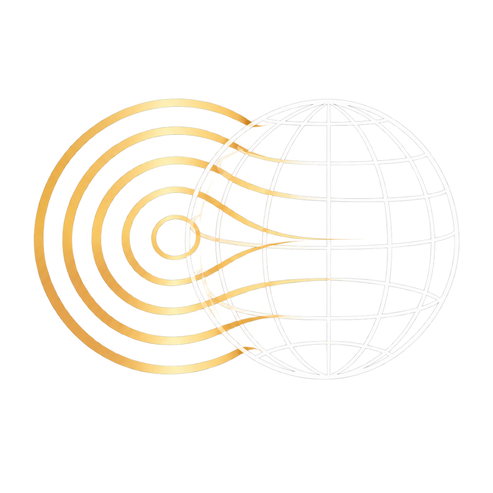

<p align="center">
  
</p>

<h1 align="center">Anime2Real</h1>

<p align="center">在浏览器本地把二次元立绘融入真实照片</p>

<p align="center">
  <a href="https://tool.talium.site/Anime2Real/"><b>在线使用</b></a> ·
  <a href="docs/Development.md">开发与部署</a> ·
  <a href="docs/Plan.md">设计文档</a> ·
  <a href="LICENSE">AGPL-3.0</a>
</p>

---

把立绘直接贴到照片上，一眼就能看出是贴上去的：光从哪边来对不上，颜色比周围鲜艳，边缘太锐利，该被前景挡住的地方也没有挡住。

Anime2Real 先分析照片的深度和光源，再按立绘所在的位置给它重新打光、匹配颜色和噪点，然后加上景深、遮挡、阴影、调色和胶片效果，让立绘看起来真的处在照片的场景里。这种作品通常称为“溶图”（Anime in Real）。

所有计算都在浏览器中完成，图片不会上传到任何服务器。

## 特性

- **本地运行**：深度模型在浏览器中推理（WebGPU，不支持时用 WebAssembly）。站点是纯静态网页，没有后端。
- **自动分析照片**：估计深度、法线和天空区域，自动给出候选光源，并识别阴天的漫射光。结果都可以手动修正。
- **随位置更新的融合**：拖动立绘时，光照和颜色会按新位置周围的环境重新计算，轮廓光和 Light Wrap 也随之更新。
- **空间感**：分层景深，点击即可对焦；站立阴影落在脚下，方向跟随主光源。树丛、玻璃、雾、水面这类前景可以挡住立绘。
- **完整的调色**：背景、立绘、全局三级调整；曲线、色轮、分离色调、`.cube` LUT 和混色层。另有 Bloom、胶片红晕、丁达尔光束、颗粒等后期效果，以及四个内置预设。
- **原图分辨率导出**：按背景照片的原始分辨率输出 PNG、JPEG 或 WebP。超出显卡纹理上限的大图分块渲染，接缝处看不出痕迹。
- **工程随时保存**：编辑内容自动保存在浏览器中，下次打开可以接着做。也可以存成 `.a2r` 工程文件，换一台电脑继续。
- **液态玻璃界面**：面板和弹出层的边缘会折射背后的画面（Chromium）。其他浏览器显示毛玻璃，也可以改用不透明面板。

## 工作流程

打开页面后，导入一张背景照片和一张带透明背景的立绘，再按左侧的八个步骤依次处理。每一步都可以随时回头修改，修改都能撤销。

| 步骤 | 内容 |
| --- | --- |
| **素材** | 拖拽、粘贴或选择图片。带透明区域的图片作为立绘，其他图片作为背景；立绘没有透明通道时会提示。 |
| **深度** | 用 [Depth Anything V2](https://github.com/DepthAnything/Depth-Anything-V2) 估计背景和立绘的深度，边缘按原图对齐。可以查看深度、法线和天空的调试视图，也可以切换模型源、推理方式和精度。 |
| **光源** | 综合可见光源、球谐光照、物体轮廓和天空亮度变化，给出候选的方向光和点光源。光源可以在画布和光照方向球上拖动、增删、改颜色，并用灰球预览照明效果。 |
| **立绘** | 摆放、缩放、旋转、翻转立绘，调整它的前后位置和接地点。可以调节的效果包括：<ul><li>颜色匹配：白平衡、影调、环境色调、饱和度收敛，并保护肤色。</li><li>三种风格的重光照（写实、柔和、赛璐璐），以及轮廓光、高光。</li><li>Light Wrap、边缘羽化、噪声匹配。</li><li>接触阴影和投影。</li></ul> |
| **景深** | 点击画面对焦，调整光圈、合焦范围和散景形状。立绘有自身的厚度，对焦在脸上时手脚会适当离焦。遮挡有六种方式：不透明、变暗、正片叠底、透明介质、水体、不遮挡。也可以用画笔圈出区域，分别设置遮挡方式。 |
| **调色** | 三级基础调整：曝光、对比度、高光阴影、白色黑色、色温色调、自然饱和度、HSL、曲线、清晰度、锐化。色彩风格：色轮、分离色调、LUT、最多四个混色层。预设：内置“阴天胶片”“黄昏逆光”“夜景霓虹”“日系清新”，也可以把当前参数导出为预设分享。 |
| **后期** | 光晕（Bloom）、胶片红晕（Halation）、丁达尔光束（立绘会挡住光线）、色差、暗角、颗粒、色调映射（AgX / Neutral）。 |
| **导出** | 按背景原图的分辨率导出 PNG、JPEG 或 WebP（可调质量），也可以保存工程文件。 |

在调色和后期步骤中，按 `\` 可以和调色前的画面对比；在其他步骤中，对比的是直接贴上去的效果。

### 快捷键

| 按键 | 作用 |
| --- | --- |
| `Ctrl+Z` / `Ctrl+Shift+Z`（或 `Ctrl+Y`） | 撤销 / 重做 |
| `Ctrl+S` / `Ctrl+O` | 保存 / 打开工程文件 |
| `F` / `1` / `+` / `-` | 适应窗口 / 100% / 放大 / 缩小 |
| 按住空格拖动 | 平移画布 |
| 方向键 / `H` | 微调立绘位置 / 水平翻转 |
| `V` | 切换调试视图 |
| `\` | 前后对比 |

## 使用要求

- **浏览器**：推荐桌面版 Chrome 或 Edge 113 及以上版本，以使用 WebGPU 渲染和推理。不支持 WebGPU 的浏览器会自动改用 WebGL2 和 WebAssembly，速度慢一些。Firefox 做过基本测试，Safari 尚未测试。
- **设备**：目前面向电脑的鼠标和键盘操作，还没有适配手机。
- **素材**：立绘需要自带透明背景，本项目不提供抠图功能。
- **首次使用**：深度模型（约 19 MB）默认从魔搭 ModelScope 下载，下载后缓存在浏览器中。下载失败时，可以在“深度”步骤的模型设置中切换到本站或 Hugging Face。

## 本地运行

需要 Node.js 22.12 及以上版本和 pnpm：

```sh
pnpm install
pnpm dev
```

构建、测试、部署到自己的服务器等内容见 [开发与部署](docs/Development.md)。

## 协作者

- [Zydr114](https://github.com/Zydr114)：项目维护者，负责需求、设计决策和验收。
- [Claude](https://www.anthropic.com/claude)（Anthropic）：参与算法设计、编码、测试和文档编写。

## 协议

本项目以 [GNU Affero 通用公共许可证 v3.0 或更新版本](LICENSE)（AGPL-3.0-or-later）发布。页面底部和“关于”对话框中提供源代码链接。如果你部署的是修改版，请按 [开发与部署](docs/Development.md#协议与源代码链接) 中的说明，把链接指向你自己的源码。

本项目使用的第三方组件及其协议，见构建产物中的 `THIRD_PARTY_NOTICES.txt`。这些组件包括：

- 深度模型 [Depth Anything V2 Small](https://huggingface.co/depth-anything/Depth-Anything-V2-Small)（Apache-2.0）
- [ONNX Runtime Web](https://github.com/microsoft/onnxruntime)（MIT）
- [three.js](https://threejs.org/)（MIT）
- [mdui](https://www.mdui.org/)（MIT）
- [Magic UI](https://magicui.design/)（MIT）
- 字体 [Instrument Serif](https://github.com/Instrument/instrument-serif)（OFL-1.1）
